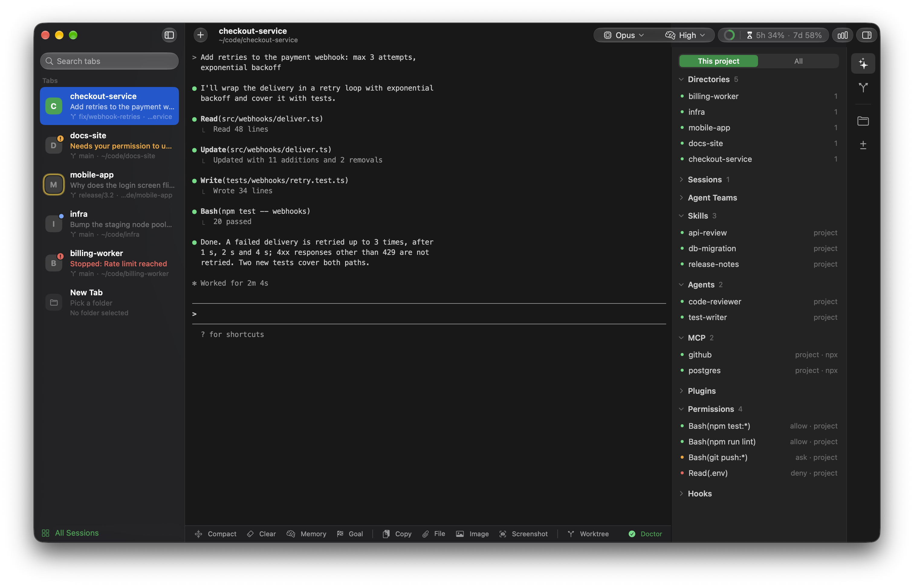

# Xylem

A native Mac app for Claude Code: every conversation in its own tab, a mark on
the one that is working or waiting for you, and your usage, Claude setup,
project files and git changes always at hand.

Xylem doesn't replace or change Claude Code. Each tab runs the real `claude`
CLI in a real terminal; Xylem adds what a terminal window lacks when you have
several sessions going for days.



**Download:** https://xylem.t1nkl.dev/ (or the [latest release](https://github.com/t1nkl/xylem/releases/latest)).
macOS 15 or later, Apple silicon or Intel. Signed and notarized; it updates
itself (new versions download in the background and install when you quit).

Xylem is an independent project and is not affiliated with Anthropic. Claude
is a trademark of Anthropic.

## What it does

- **Tabs that know what Claude is doing.** Working, finished, or waiting for
  your permission - shown on the tab, in the Dock badge and as one macOS
  notification per event. Xylem learns this from Claude Code hooks and a
  status line it passes with `--settings` (your own status line still
  shows); your own settings files are never modified.
- **Tabs in the sidebar or above the terminal.** The sidebar shows each tab's
  latest prompt, branch and folder; above the terminal (Settings > General)
  the terminal gets the full width, the tabs scroll sideways and reorder by
  dragging, and hovering a tab shows its whole prompt. All Sessions shows
  every tab's context, cost and state at a glance.
- **Model and effort in the toolbar.** The model and effort level the tab's
  Claude runs at, shown as soon as it starts, and menus to switch them. A new
  effort level applies to that session only (Claude Code 2.1.300 or later;
  Max with earlier versions too).
- **Sessions survive restarts.** Tabs come back and continue their own
  conversation (`claude --resume`); a restored tab starts only when you open
  it. If the session is already open elsewhere, the tab forks it instead of
  writing to the same transcript.
- **Usage and costs.** Tokens and API-price costs by model, project, session
  and day, subagents included, read incrementally from Claude Code's own
  transcripts.
- **Your Claude setup in one panel.** Skills, agents, MCP servers, plugins,
  permissions and hooks of the current project (or everything), merged from
  the global, project and local settings.
- **Files and changes next to the conversation.** A file tree with a
  syntax-highlighted preview, the diff of every changed file, a Git panel,
  and worktree tabs on a new branch.
- **Prompt search.** ⌘K finds any prompt you ever typed and jumps back into
  that session.
- **Terminal details.** Control and Command shortcuts work on non-Latin
  keyboard layouts, Shift+Return makes a new line, ⌘Q asks while Claude is
  working, and the Doctor tells you when `claude` isn't on your `PATH` - with
  the command that fixes it.

## Requirements

- macOS 15 (Sequoia) or later, Apple silicon or Intel
- Claude Code, installed any way (Anthropic's installer is the recommended
  one: `curl -fsSL https://claude.ai/install.sh | bash`). Tabs run `claude`
  through your login shell, so nvm, volta, mise and Homebrew installs work; a
  custom `CLAUDE_CONFIG_DIR` is honoured.

## Building from source

Requires Xcode 26 or later.

```
git clone https://github.com/t1nkl/xylem.git
cd xylem
open Xylem.xcodeproj
```

In Xcode, choose your own team in the Xylem target's Signing & Capabilities
(the project is set up for the maintainer's team), trust SwiftTerm's build
plugin once when asked, and run with ⌘R. From the command line, without an
Apple developer account (signed ad hoc, for your own Mac):

```
xcodebuild -downloadComponent MetalToolchain   # once
xcodebuild -project Xylem.xcodeproj -scheme Xylem -configuration Debug \
  -skipPackagePluginValidation DEVELOPMENT_TEAM= CODE_SIGN_IDENTITY=- build
```

Debug builds never check for updates and never send crash reports. The app
sandbox is off on purpose: Xylem runs login shells in a pty, which macOS
doesn't allow sandboxed apps to do (`can't set tty pgrp`).

**If you publish your own build**, give it a different name, icon and bundle
identifier, and change `SUFeedURL` and `SUPublicEDKey` in
`Config/Xylem-Info.plist`, or your build will offer to update itself to the
official releases. Crash reports are sent only by the official bundle
identifier; for your own, set your Sentry DSN in `Xylem/App/CrashReporting.swift`.

## Tests

The unit tests (`XylemTests/`, Swift Testing) are hostless - they never launch
the app or touch your real `~/.claude` and `~/.xylem`.

```
xcodebuild -project Xylem.xcodeproj -scheme Xylem -configuration Debug test \
  -only-testing:XylemTests -skipPackagePluginValidation \
  DEVELOPMENT_TEAM= CODE_SIGN_IDENTITY=-
```

After a Claude Code update, `make check-claude` runs the installed `claude` for
real in a temporary folder (a few small Haiku turns, about a cent) and checks
every format and behaviour Xylem relies on: hook events, transcripts, usage
fields, the terminal protocol. One line per feature: OK, LOOK or FAIL.

## Architecture

SwiftUI + AppKit, with [SwiftTerm](https://github.com/migueldeicaza/SwiftTerm)
for the terminal. The code is split by domain:

| Folder | What lives there |
| --- | --- |
| `Terminal/` | the pty session, shell launch, key handling, activity timing |
| `Claude/` | readers for Claude Code's settings, skills, agents, MCP, hooks bridge, tab state |
| `Sessions/` | tabs, session binding, transcripts, prompt search |
| `Usage/` | the usage aggregator, its caches, model pricing |
| `Files/`, `Git/`, `Highlight/` | the Files / Changes drawer and the Git panel |
| `Views/` | SwiftUI views, presentational, interactions bubble up through closures |
| `App/` | the composition root, updates (Sparkle), crash reports, notifications |

Readers sit behind protocols and run off the main thread; view models are
`@Observable` facades; models are value types. Long-running work is
incremental (only appended bytes of a transcript are read again), and the app
idles at about 0.1% CPU.

## State on disk

Xylem keeps its own state in `~/.xylem/` (tabs, caches, the hook and status
line scripts, the prompt search index, hotkey overrides) and only reads
Claude Code's files.
Nothing leaves your Mac except requests to status.claude.com and skills.sh,
the hourly update check (`appcast.xml` on this repository's site), and crash
reports to Sentry (stack trace, macOS version, Mac model, app version - no
prompts, paths, breadcrumbs or IP; off in Settings > Updates & Privacy).

## Contributing

Bug reports and ideas are welcome in [Issues](https://github.com/t1nkl/xylem/issues).
Pull requests are welcome too - please read [CONTRIBUTING.md](CONTRIBUTING.md)
first: contributions need a signed [Contributor License Agreement](CLA.md).
Security problems: please report them privately, see [SECURITY.md](SECURITY.md).

## License

Copyright © 2026 t1nkl.

Xylem is free software: you can redistribute it and/or modify it under the
terms of the GNU General Public License, version 3 only (GPL-3.0-only), as
published by the Free Software Foundation. It is distributed in the hope that it will be useful, but
WITHOUT ANY WARRANTY; without even the implied warranty of MERCHANTABILITY or
FITNESS FOR A PARTICULAR PURPOSE. See [LICENSE](LICENSE) for details.

The license gives no right to use the name "Xylem" or its logo and app icon to
identify other software (GPL v3, section 7e): forks and modified versions
must use a different name and icon.

Third-party software: SwiftTerm (MIT), Sparkle (MIT, with BSD and zlib parts),
the Sentry SDK (MIT) and highlight.js (BSD-3). Their license texts are in
`Xylem/Licenses/` and in the app under Help > Open-Source Licenses.
